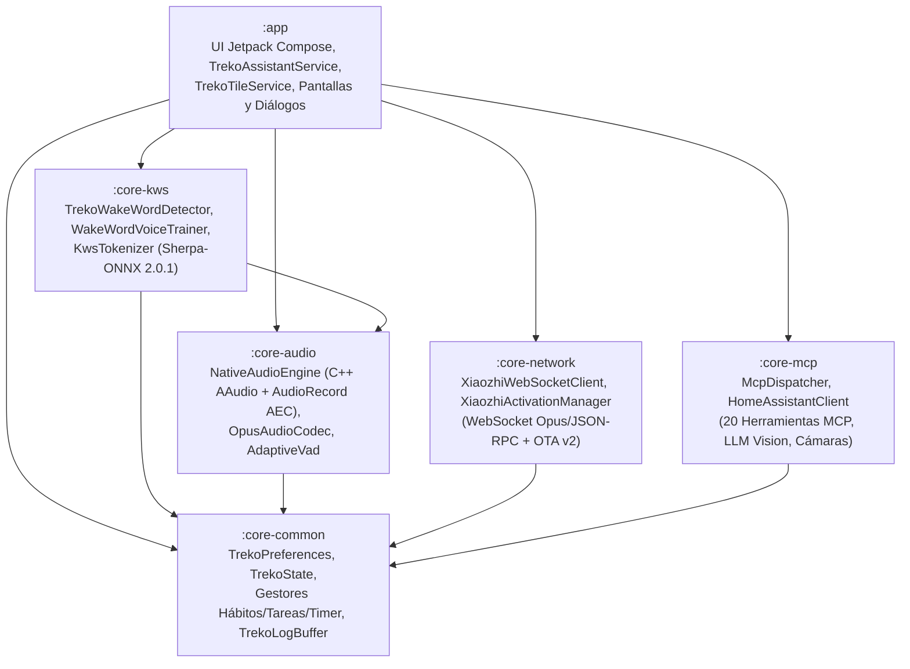

<div align="center">

# Treko AI Assistant para Android

**Asistente de voz IA de código abierto y bilingüe (EN/ES) para Android basado en el protocolo Xiaozhi, detección local de palabra de activación con Sherpa-ONNX, audio nativo de baja latencia y control de Home Assistant vía MCP.**

[](https://github.com/baxner/Treko/actions/workflows/android-build.yml)
-3DDC84?logo=android&logoColor=white)


**[English (README.md)](README.md)** | **Español**

</div>

---

## Tabla de Contenidos

- [Descripción General](#descripción-general)
- [Características y Capacidades](#características-y-capacidades)
- [Stack Tecnológico y Arquitectura](#stack-tecnológico-y-arquitectura)
- [Prerrequisitos](#prerrequisitos)
- [Guía de Compilación e Instalación](#guía-de-compilación-e-instalación)
- [Guía de Configuración (Xiaozhi y Home Assistant)](#guía-de-configuración-xiaozhi-y-home-assistant)
- [Solución de Problemas](#solución-de-problemas)
- [Contribuir](#contribuir)

---

## Descripción General

**Treko Assistant** es un compañero conversacional nativo de inteligencia artificial para **Android**, construido sobre el ecosistema **Xiaozhi**. Combina una interfaz animada y expresiva en **Jetpack Compose** con detección local de palabra de activación mediante **Sherpa-ONNX** (`"Treko"` o frase personalizada), streaming de voz Opus full-duplex con cancelación de eco por hardware, entrenamiento guiado de voz y una suite integrada de herramientas **Model Context Protocol (MCP)** para **Home Assistant**, análisis de cámaras con **LLM Vision**, productividad y control del dispositivo Android.

---

## Características y Capacidades

### 1. Protocolo de Voz Xiaozhi AI (`core-network`)
- **Streaming WebSocket full-duplex** (`wss://api.tenclass.net/xiaozhi/v1/` o servidor personalizado) con tramas binarias Opus y mensajes de control JSON.
- **Vinculación oficial Xiaozhi OTA v2**: Solicita un código de verificación de 6 dígitos en `https://api.tenclass.net/xiaozhi/ota/` mediante firma HMAC-SHA256 y espera la aprobación en la consola.
- **Identidad única por instalación**: Genera automáticamente una dirección MAC localmente administrada (`02:xx:xx:xx:xx:xx`) y una clave HMAC de 256 bits con `SecureRandom` en cada dispositivo, sin credenciales ni identificadores fijos en el código.
- **Conexión resiliente**: Ping keepalive cada 20 s, timeout extendido de 50 s para análisis de visión y reconexión exponencial con jitter (`2s`–`30s`).

### 2. Audio de Baja Latencia, AEC por Hardware y Barge-In (`core-audio`)
- **Motor nativo C++ AAudio** (`oboe_audio_engine.cpp` en modo `AAUDIO_PERFORMANCE_MODE_LOW_LATENCY`, PCM16 mono 16 kHz) junto con `AudioRecord` de Android usando **Cancelación de Eco Acústico (AEC)**, **Supresión de Ruido (NS)** y **Control Automático de Ganancia (AGC)** por hardware.
- **Sesión de audio compartida y reproducción dúplex**: Coordina el `audioSessionId` de `AudioRecord` y `AudioFocusRequest` con `AudioTrack` (`USAGE_ASSISTANT` / modo eco `VOICE_COMMUNICATION`) para interrumpir (barge-in) con precisión mientras Treko habla.
- **Códec Opus no bloqueante (`OpusAudioCodec`)**: Codificación/decodificación vía `MediaCodec` (`audio/opus`) con candados separados para encoder, decoder y track, evitando que `AudioTrack.write` bloquee la captura del micrófono o la cancelación inmediata por barge-in.
- **Telemetría para Lip-Sync TTS**: Expone `playbackLevel: StateFlow<AudioLevel>` desde el PCM decodificado para animar el ecualizador y el aura facial al ritmo de la voz de Treko.
- **VAD Adaptativo (`AdaptiveVad`)**: Eliminación de offset DC, seguimiento asimétrico del piso de ruido, filtro de tasa de cruces por cero (ZCR), hangover y congelación del piso de ruido durante la reproducción TTS.

### 3. Palabra de Activación Local y Entrenamiento Guiado (`core-kws`)
- **KWS offline con Zipformer Transducer**: Motor **Sherpa-ONNX `2.0.1`** con boosting fonético bilingüe (`EN`/`ES`) para `"Treko"` en `core-kws/src/main/assets/models/en/keywords.txt` y frases personalizables con `KwsTokenizer`.
- **Detección filtrada por VAD con pre-roll**: `AdaptiveVad` filtra las tramas antes de pasar al decodificador neuronal usando un buffer circular de 300 ms de pre-roll y limitador soft-knee para reducir CPU y falsos positivos.
- **Entrenamiento Guiado en 3 Pasos (`WakeWordTrainingDialog` + `WakeWordVoiceTrainer`)**:
  1. **Medición del ruido ambiente** en tu habitación.
  2. **3 grabaciones de tu voz** con validación de calidad en tiempo real (`OK`, `TOO_QUIET`, `TOO_NOISY`, `CLIPPED`, `TOO_SHORT`, `TOO_LONG`), aumentación multi-SNR/ganancia (`0.55x`, `1.0x`, `1.35x`, repetición con ruido), barrido empírico sobre `KeywordSpotter` para calibrar `keywordsScore` y `keywordsThreshold`, y extracción de huella vocal espectro-prosódica de 20 dimensiones (`WakeWordVoicePrint`).
  3. **Verificación local en vivo** (pausando envíos al servidor durante la prueba) antes de guardar la calibración.

### 4. Cara Expresiva e Interfaz en Jetpack Compose (`app`)
- **44 animaciones GIF incluidas** (`app/src/main/assets/gifs/`) asociadas a los estados conversacionales (`IDLE`, `LISTENING`, `THINKING`, `SPEAKING`, `ERROR`) y emociones enviadas por el servidor.
- **Renderizado sin recomposiciones en Canvas**:
  - `ReactiveEqualizer` usa `Modifier.drawWithCache` + `withFrameNanos` con suavizado asimétrico de ataque/liberación y modos visuales diferenciados por estado, reaccionando al micrófono al escuchar y a `playbackLevel` al hablar.
  - `TrekoFace` comparte un `ImageLoader` singleton de Coil para GIFs y utiliza lambdas `graphicsLayer`, anillos/ondas con `drawWithCache` y físicas de resorte (spring) para animaciones fluidas a 60/120 fps.
- **Pantallas y Herramientas Modulares**:
  - **Cara** (`FaceScreen` con cajón desplegable de historial de chat)
  - **Hábitos** (`HabitsScreen` + `TrekoHabitManager` persistente)
  - **Tareas** (`TasksScreen` + `TrekoTaskManager` persistente)
  - **Temporizador** (`TimerScreen` con arco circular animado de Pomodoro/cuenta regresiva y `TrekoTimerManager` monotónico sin deriva)
  - **Ajustes** (`SettingsScreen` con `reloadConfiguration()` en vivo), **Asistente de Configuración** (`SetupWizardScreen`), **Visor de Cámaras** (`CameraViewerDialog`), **Entrenamiento de Voz** (`WakeWordTrainingDialog`) y **Diagnósticos** (`DiagnosticsDialog` + `TrekoLogBuffer`)
- **Integración con Android**:
  - Servicio en primer plano `TrekoAssistantService` (`FOREGROUND_SERVICE_TYPE_MICROPHONE`) con notificación dinámica y botones rápidos (Hablar/Detener).
  - **Acceso rápido (Quick Settings Tile)** (`TrekoTileService`, compatible con Android 14 / API 34+).
  - Localización completa en **Español e Inglés** (`res/values/strings.xml`, `res/values-es/strings.xml`) e intents bilingües de reposo/despedida.

### 5. Control de Hogar Home Assistant, LLM Vision y Herramientas Android (`core-mcp`)
Treko expone **20 herramientas MCP JSON-RPC 2.0** al modelo de Xiaozhi mediante WebSocket:

| Categoría | Herramientas MCP | Capacidades |
|---|---|---|
| **Hogar Inteligente (Home Assistant)** | `home_assistant_control`, `home_assistant_call_service`, `home_assistant_list_entities`, `home_assistant_get_entity_state`, `home_assistant_list_services`, `home_assistant_broadcast`, `trigger_scene` | Coincidencia difusa de entidades, soporte de temperatura blanca CCT y alias de colores EN/ES, cambio de entradas HDMI/fuentes, reproducción multimedia, anuncios TTS, caché breve de `/api/states` |
| **Cámaras y LLM Vision** | `view_camera`, `analyze_camera` | Modal en app con modo **En vivo / Captura** (`CameraViewerDialog`), descubrimiento dinámico de proveedores `llmvision` / `image_analyzer` en Home Assistant (sin IDs fijos) y ranking inteligente de cámaras |
| **Productividad y Memoria** | `manage_habits`, `manage_tasks`, `manage_timer`, `manage_vault_memory` | Hábitos persistentes, tareas diarias, temporizadores Pomodoro/cuenta regresiva, memoria clave-valor persistente (Vault) |
| **Dispositivo Android e Info** | `get_device_status`, `control_flashlight`, `open_app`, `set_device_volume`, `set_alarm`, `media_player_playback`, `get_weather` | Estado de batería y fecha/hora, linterna, apertura de apps (`<queries>`), volumen del sistema, alarmas, controles multimedia, clima vía Open-Meteo |

---

## Stack Tecnológico y Arquitectura

- **Lenguaje y Build**: Kotlin `2.0.0`, Android Gradle Plugin `8.3.2`, Gradle `8.7`, Java 17
- **UI**: Jetpack Compose (BOM `2024.06.00`), Material 3, Coil (`coil-compose`, `coil-gif`)
- **Audio Nativo / ML**: Android NDK `26.1.10909125` (`r26b`), CMake `3.22.1`, AAudio C++17, MediaCodec Opus, Sherpa-ONNX `2.0.1` AAR (Zipformer Transducer ONNX)
- **Red y Almacenamiento**: OkHttp `4.12.0`, `SharedPreferences` de Android, dependencias Room (`2.6.1` en `core-mcp`), `TrekoLogBuffer`



### Estructura del Repositorio

```text
Treko/
├── .github/workflows/android-build.yml   # Pipeline CI en GitHub Actions (tests + APK debug)
├── app/                                  # UI Compose, servicios, GIFs, strings EN/ES, ProGuard
├── core-audio/                           # Motor JNI C++ AAudio, AudioRecord AEC, Opus, AdaptiveVad
├── core-common/                          # Modelos de dominio, preferencias SecureRandom, gestores, logs
├── core-kws/                             # Sherpa-ONNX KWS, modelos ONNX, WakeWordVoiceTrainer, tests
├── core-mcp/                             # Dispatcher JSON-RPC MCP, cliente Home Assistant y LLM Vision
├── core-network/                         # Cliente WebSocket Xiaozhi v1 y activación OTA v2
├── gradle/                               # Gradle wrapper y catálogo libs.versions.toml
├── local-repo/                           # Repo Maven local (descarga automática de sherpa-onnx-2.0.1.aar)
├── build.gradle.kts
├── settings.gradle.kts
└── gradle.properties
```

---

## Prerrequisitos

Antes de compilar localmente, asegúrate de contar con:

1. **JDK 17** (`JAVA_HOME` apuntando a Java 17).
2. **Android SDK** con:
   - **Android SDK Platform 34** (`compileSdk = 34`, `targetSdk = 34`)
   - **Android SDK Build-Tools** (`34.0.0`+)
   - **Android NDK `26.1.10909125`** (r26b) — requerido por `:core-audio`
   - **CMake `3.22.1`** — requerido por `:core-audio`
3. **Acceso a internet en la primera sincronización/compilación**: `settings.gradle.kts` descarga y verifica automáticamente por SHA-256 el archivo `sherpa-onnx-2.0.1.aar` (~49 MB) dentro de `local-repo/` (excluido de Git en `.gitignore`).
4. *(Opcional para instalar en teléfono)* **ADB** (`Android Debug Bridge`) con Depuración USB o Depuración Inalámbrica activada en un dispositivo **Android 8.0+ (API 26+)**.

---

## Guía de Compilación e Instalación

### Opción A: Descargar el APK Debug desde GitHub Actions (Sin SDK Local)
1. Entra al repositorio en GitHub y abre la pestaña **Actions**.
2. Selecciona la ejecución más reciente con éxito de **Build Treko Android App**.
3. Descarga el artefacto **`TrekoAssistant-debug`** e instala `TrekoAssistant-debug.apk` en tu teléfono Android.

### Opción B: Compilar desde Línea de Comandos (Linux / macOS / Windows)

1. **Clonar el repositorio**:
   ```bash
   git clone https://github.com/baxner/Treko.git
   cd Treko
   ```

2. **Indicar la ruta del Android SDK** (si no tienes `ANDROID_HOME` o `ANDROID_SDK_ROOT` definido, crea `local.properties` — nunca lo subas a Git):
   ```properties
   sdk.dir=/ruta/a/tu/Android/Sdk
   ```

3. **Ejecutar pruebas unitarias** (en la primera ejecución Gradle descargará y verificará `sherpa-onnx-2.0.1.aar` automáticamente):
   - **Linux / macOS**:
     ```bash
     ./gradlew testDebugUnitTest
     ```
   - **Windows (PowerShell / CMD)**:
     ```bat
     .\gradlew.bat testDebugUnitTest
     ```

4. **Generar el APK debug**:
   - **Linux / macOS**:
     ```bash
     ./gradlew :app:assembleDebug
     ```
   - **Windows**:
     ```bat
     .\gradlew.bat :app:assembleDebug
     ```
   El APK generado quedará en:
   ```text
   app/build/outputs/apk/debug/app-debug.apk
   ```

5. **Instalar directamente en un dispositivo Android conectado vía ADB**:
   ```bash
   adb install -r app/build/outputs/apk/debug/app-debug.apk
   ```

> **Nota sobre compilaciones Release y firma**: `:app:assembleDebug` genera un APK listo para instalar firmado con la clave debug estándar. `:app:assembleRelease` genera un APK sin firmar salvo que configures tu propio keystore local (o uses **Build > Generate Signed Bundle / APK** en Android Studio). Los archivos de firma (`*.jks`, `*.keystore`, `keystore.properties`) y `local.properties` están ignorados en `.gitignore`—nunca subas claves ni secretos al repositorio.

### Opción C: Compilar y Ejecutar en Android Studio
1. Abre **Android Studio** -> **Open** -> selecciona la carpeta `Treko/`.
2. En **Tools > SDK Manager > SDK Tools**, verifica que **NDK (Side by side) `26.1.10909125`** y **CMake `3.22.1`** estén instalados, y confirma que Gradle use **JDK 17** (**Settings > Build, Execution, Deployment > Build Tools > Gradle**).
3. Espera a que termine **Gradle Sync** (descargará `sherpa-onnx-2.0.1.aar` automáticamente en `local-repo/` la primera vez).
4. Selecciona tu teléfono o emulador (API 26+) y pulsa **Run** (`Shift+F10`).

### Configuración Manual / Modo Sin Conexión (`--offline`)
Si necesitas compilar con `--offline`, descarga `sherpa-onnx-2.0.1.aar` previamente (ver [local-repo/README.md](local-repo/README.md)):
```bash
mkdir -p local-repo/com/k2fsa/sherpa/sherpa-onnx/2.0.1
curl -L -f -o local-repo/com/k2fsa/sherpa/sherpa-onnx/2.0.1/sherpa-onnx-2.0.1.aar \
  https://github.com/k2-fsa/sherpa-onnx/releases/download/v2.0.1/sherpa-onnx-2.0.1.aar
echo "a8d09d1d32f3eb8520482c6d3d43fae674681c5b050385967c70a3c2c9bf0ee7  local-repo/com/k2fsa/sherpa/sherpa-onnx/2.0.1/sherpa-onnx-2.0.1.aar" | sha256sum -c -
```

---

## Guía de Configuración (Xiaozhi y Home Assistant)

### 1. Consola Xiaozhi (Asistente Inicial)
Al abrir Treko por primera vez, el **Setup Wizard** te guiará paso a paso:
1. **Permisos**: Concede permiso de **Micrófono** (`RECORD_AUDIO`), **Cámara** (opcional) y **Notificaciones** (Android 13+).
2. **Vincular Dispositivo en Xiaozhi**:
   - Treko genera automáticamente un Device ID (MAC) único y una clave HMAC en el primer arranque.
   - Pulsa **Obtener código de verificación** para solicitar un código OTA v2 de 6 dígitos en `https://api.tenclass.net/xiaozhi/ota/`.
   - Entra a tu **Consola de Xiaozhi** (ej. `xiaozhi.me`), añade un dispositivo en tu agente e introduce el **código de 6 dígitos**.
   - Treko detectará la aprobación automáticamente y se conectará a `wss://api.tenclass.net/xiaozhi/v1/` (también puedes usar una URL WebSocket y token propios en **Ajustes**).

### 2. Configuración Opcional de Home Assistant
Para controlar tu hogar inteligente, ver cámaras y usar LLM Vision:
1. En Home Assistant ve a tu **Perfil > Seguridad > Tokens de acceso de larga duración** y crea un token nuevo.
2. En el **Setup Wizard** o en la pestaña **Ajustes** de Treko introduce:
   - **URL de Home Assistant**: por ejemplo `http://192.168.1.50:8123`, `http://homeassistant.local:8123` o tu dominio `https://...`.
   - **Token de acceso de larga duración**: pega el token generado.
3. Pulsa **Probar conexión** para verificar acceso y luego **Guardar**.
4. *(Opcional para `analyze_camera`)* Instala la integración **LLM Vision** (`llmvision`) o `image_analyzer` en Home Assistant; Treko detectará automáticamente tu proveedor configurado en tiempo de ejecución.

### 3. Entrenamiento Guiado de Palabra de Activación
Para maximizar la precisión de `"Treko"` en tu entorno:
1. Ve a **Ajustes** -> **Entrenar / Calibrar Voz**.
2. Mantén silencio durante la medición del **Piso de Ruido Ambiente**.
3. Di `"Treko"` con naturalidad **3 veces**: el entrenador evalúa SNR/saturación, realiza aumentación multi-SNR, calibra `keywordsScore` y `keywordsThreshold` y guarda tu `WakeWordVoicePrint` local.
4. Di `"Treko"` en el paso de **Verificación en Vivo** para comprobar la detección antes de guardar.

---

## Solución de Problemas

- **Gradle falla con `Could not find com.k2fsa.sherpa:sherpa-onnx:2.0.1`**:
  Asegúrate de tener conexión a internet en la primera compilación (sin `--offline`) para que `settings.gradle.kts` descargue el AAR, o sigue los pasos manuales de `curl` + `sha256sum` en [local-repo/README.md](local-repo/README.md).
- **Error de CMake / NDK al compilar `:core-audio`**:
  Instala **NDK `26.1.10909125`** y **CMake `3.22.1`** desde el SDK Manager de Android Studio (`sdkmanager "ndk;26.1.10909125" "cmake;3.22.1"`).
- **Error de versión de Java en Gradle**:
  Verifica que `JAVA_HOME` apunte a **JDK 17** (`java -version`).
- **La palabra de activación no responde o se activa con la TV/otras voces**:
  Abre **Ajustes > Entrenar / Calibrar Voz** para recalibrar según el ruido de tu habitación y activar el filtro adaptativo VAD / verificación por huella vocal. Usa **Diagnósticos** en Ajustes para inspeccionar RMS, SNR, tramas KWS y descartes del VAD en tiempo real.
- **El servicio en segundo plano o el micrófono no inicia**:
  Comprueba que el permiso de **Micrófono** esté concedido en Ajustes de Android (Treko muestra un aviso superior con acceso directo si falta `RECORD_AUDIO`).
- **No conecta con Home Assistant por HTTP local (`http://192.168.x.x:8123`)**:
  Verifica que el teléfono esté en la misma red local/VLAN y prueba la URL desde **Ajustes**. El tráfico HTTP en texto claro está permitido en `app/src/main/res/xml/network_security_config.xml` específicamente para compatibilidad con Home Assistant en LAN privada, mientras los endpoints públicos de Xiaozhi usan TLS/WSS.

---

## Contribuir

¡Las contribuciones son bienvenidas! Consulta [CONTRIBUTING.md](CONTRIBUTING.md) antes de abrir un Pull Request.
