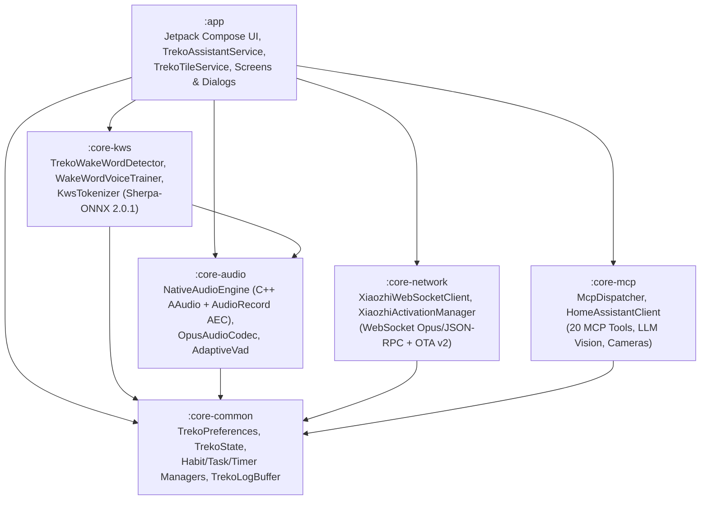

<div align="center">

# Treko AI Assistant for Android

**Open-source, bilingual (EN/ES) AI voice companion for Android powered by the Xiaozhi protocol, on-device Sherpa-ONNX wake-word detection, low-latency native audio, and Home Assistant MCP control.**

[](https://github.com/baxner/Treko/actions/workflows/android-build.yml)
-3DDC84?logo=android&logoColor=white)


**English** | **[Español (README.es.md)](README.es.md)**

</div>

---

## Table of Contents

- [Overview](#overview)
- [Features & Capabilities](#features--capabilities)
- [Tech Stack & Architecture](#tech-stack--architecture)
- [Prerequisites](#prerequisites)
- [Build & Install Guide](#build--install-guide)
- [Configuration Guide (Xiaozhi & Home Assistant)](#configuration-guide-xiaozhi--home-assistant)
- [Troubleshooting](#troubleshooting)
- [Contributing](#contributing)

---

## Overview

**Treko Assistant** is a native Android conversational AI companion built around the **Xiaozhi** voice assistant ecosystem. It combines an expressive animated Jetpack Compose interface with on-device **Sherpa-ONNX** wake-word detection (`"Treko"` or custom phrase), full-duplex Opus voice streaming with hardware echo cancellation, guided voice-training calibration, and a built-in **Model Context Protocol (MCP)** tool suite for **Home Assistant** smart home control, **LLM Vision** camera analysis, productivity, and Android device automation.

---

## Features & Capabilities

### 1. Xiaozhi AI Voice Protocol (`core-network`)
- **Full-duplex WebSocket streaming** (`wss://api.tenclass.net/xiaozhi/v1/` or custom server URL) with binary Opus frames and JSON control messages.
- **Official Xiaozhi OTA v2 device linking**: Fetches a 6-digit verification code via `https://api.tenclass.net/xiaozhi/ota/` using HMAC-SHA256 challenge signing and polls for console approval.
- **Per-install unique identity**: Generates a unique `SecureRandom` locally-administered MAC address (`02:xx:xx:xx:xx:xx`) and 256-bit HMAC key per installation—no hardcoded device IDs or shared secrets.
- **Resilient connectivity**: 20-second WebSocket ping keepalive, extended 50-second vision timeouts, and jittered exponential reconnect backoff (`2s`–`30s`).

### 2. Low-Latency Audio, Hardware AEC & Barge-In (`core-audio`)
- **Native C++ AAudio engine** (`oboe_audio_engine.cpp` using `AAUDIO_PERFORMANCE_MODE_LOW_LATENCY`, 16 kHz mono PCM16) alongside Android `AudioRecord` with hardware **Acoustic Echo Canceler (AEC)**, **Noise Suppressor (NS)**, and **Automatic Gain Control (AGC)**.
- **Shared audio session & duplex playback**: Coordinates `AudioRecord` `audioSessionId` and `AudioFocusRequest` with `AudioTrack` (`USAGE_ASSISTANT` / `VOICE_COMMUNICATION` echo mode) for reliable barge-in while Treko is speaking.
- **Non-blocking Opus codec (`OpusAudioCodec`)**: Android `MediaCodec` (`audio/opus`) encode/decode with isolated encoder, decoder, and track locks so blocking `AudioTrack.write` never stalls microphone capture or instant barge-in cancellation.
- **TTS Lip-Sync telemetry**: Exposes `playbackLevel: StateFlow<AudioLevel>` from decoded playback PCM to drive the equalizer and companion aura in real time.
- **Adaptive VAD (`AdaptiveVad`)**: DC-offset removal, asymmetric noise-floor tracking, zero-crossing rate (ZCR) speech guard, hangover frames, and playback-aware noise-floor freeze.

### 3. On-Device Wake Word & Guided Voice Training (`core-kws`)
- **Offline Zipformer Transducer KWS**: Powered by **Sherpa-ONNX `2.0.1`** with bundled bilingual (`EN`/`ES`) phonetic boosting for `"Treko"` in `core-kws/src/main/assets/models/en/keywords.txt` and customizable wake phrases via `KwsTokenizer`.
- **VAD-gated KWS with pre-roll**: `AdaptiveVad` gates frames before neural decoding using a 300 ms pre-roll ring buffer and soft-knee gain limiting to minimize CPU usage and false triggers.
- **Guided 3-Step Voice Training (`WakeWordTrainingDialog` + `WakeWordVoiceTrainer`)**:
  1. **Ambient noise-floor measurement** in your environment.
  2. **3 spoken wake-word takes** with live quality validation (`OK`, `TOO_QUIET`, `TOO_NOISY`, `CLIPPED`, `TOO_SHORT`, `TOO_LONG`), multi-SNR/gain augmentation (`0.55x`, `1.0x`, `1.35x`, noisy replay), empirical `KeywordSpotter` score/threshold sweep, and a 20-D spectral-prosodic `WakeWordVoicePrint`.
  3. **Live local verification** (server triggering paused during testing) before saving calibrated parameters and voiceprint.

### 4. Expressive Companion Face & Jetpack Compose UI (`app`)
- **44 bundled animated GIF expressions** (`app/src/main/assets/gifs/`) mapped to assistant states (`IDLE`, `LISTENING`, `THINKING`, `SPEAKING`, `ERROR`) and server-sent emotion cues.
- **Zero-recomposition Canvas rendering**:
  - `ReactiveEqualizer` uses `Modifier.drawWithCache` + `withFrameNanos` with asymmetric attack/release smoothing and distinct visual modes per state, reacting to mic input during listening and TTS `playbackLevel` during speaking.
  - `TrekoFace` shares a singleton Coil GIF `ImageLoader` and uses `graphicsLayer` lambdas, `drawWithCache` sonar/orbital/glow rings, and spring physics for smooth 60/120 fps motion.
- **Modular Screens & Tools**:
  - **Face** (`FaceScreen` + collapsible chat history drawer)
  - **Habits** (`HabitsScreen` + persistent `TrekoHabitManager`)
  - **Tasks** (`TasksScreen` + persistent `TrekoTaskManager`)
  - **Timers** (`TimerScreen` with animated circular Pomodoro/countdown progress arc and monotonic drift-free `TrekoTimerManager`)
  - **Settings** (`SettingsScreen` + live `reloadConfiguration()`), **Setup Wizard** (`SetupWizardScreen`), **Camera Viewer** (`CameraViewerDialog`), **Voice Training** (`WakeWordTrainingDialog`), and **Diagnostics** (`DiagnosticsDialog` + `TrekoLogBuffer`)
- **System Integration**:
  - Background `TrekoAssistantService` (`FOREGROUND_SERVICE_TYPE_MICROPHONE`) with dynamic Talk/Stop notification actions.
  - Android **Quick Settings Tile** (`TrekoTileService`, API 34+ compatible).
  - Full **English and Spanish** localization (`res/values/strings.xml`, `res/values-es/strings.xml`) and bilingual sleep voice intents.

### 5. Home Assistant MCP Smart Home, LLM Vision & Device Tools (`core-mcp`)
Treko exposes **20 JSON-RPC 2.0 MCP tools** to the Xiaozhi LLM over WebSocket:

| Category | MCP Tools | Capabilities |
|---|---|---|
| **Smart Home (Home Assistant)** | `home_assistant_control`, `home_assistant_call_service`, `home_assistant_list_entities`, `home_assistant_get_entity_state`, `home_assistant_list_services`, `home_assistant_broadcast`, `trigger_scene` | Fuzzy entity matching, CCT white temperature & EN/ES color aliases, HDMI/input source switching, media playback, TTS announcements, short-lived `/api/states` caching |
| **Cameras & LLM Vision** | `view_camera`, `analyze_camera` | In-app Live/Snapshot camera modal (`CameraViewerDialog`), dynamic Home Assistant `llmvision` / `image_analyzer` provider discovery (no hardcoded provider IDs), camera candidate ranking |
| **Productivity & Memory** | `manage_habits`, `manage_tasks`, `manage_timer`, `manage_vault_memory` | Persistent habits, daily tasks, Pomodoro/countdown timers, key-value long-term Vault memory |
| **Android Device & Info** | `get_device_status`, `control_flashlight`, `open_app`, `set_device_volume`, `set_alarm`, `media_player_playback`, `get_weather` | Battery/date/time status, camera torch toggle, launcher app opening (`<queries>`), volume control, system alarms, media controls, Open-Meteo weather lookup |

---

## Tech Stack & Architecture

- **Language & Build**: Kotlin `2.0.0`, Android Gradle Plugin `8.3.2`, Gradle `8.7`, Java 17
- **UI**: Jetpack Compose (BOM `2024.06.00`), Material 3, Coil (`coil-compose`, `coil-gif`)
- **Native / ML Audio**: Android NDK `26.1.10909125` (`r26b`), CMake `3.22.1`, AAudio C++17, MediaCodec Opus, Sherpa-ONNX `2.0.1` AAR (Zipformer Transducer ONNX)
- **Networking & Storage**: OkHttp `4.12.0`, Android `SharedPreferences`, Room dependencies (`2.6.1` in `core-mcp`), `TrekoLogBuffer`



### Repository Layout

```text
Treko/
├── .github/workflows/android-build.yml   # GitHub Actions CI (unit tests + debug APK)
├── app/                                  # Compose UI, services, GIF assets, EN/ES strings, ProGuard
├── core-audio/                           # C++ AAudio JNI engine, AudioRecord AEC, Opus codec, AdaptiveVad
├── core-common/                          # Domain models, SecureRandom preferences, managers, log buffer
├── core-kws/                             # Sherpa-ONNX KWS, ONNX models, WakeWordVoiceTrainer, tests
├── core-mcp/                             # JSON-RPC MCP dispatcher, Home Assistant REST & LLM Vision
├── core-network/                         # Xiaozhi WebSocket v1 client & OTA v2 activation
├── gradle/                               # Gradle wrapper + libs.versions.toml version catalog
├── local-repo/                           # Local Maven repo (auto-bootstraps sherpa-onnx-2.0.1.aar)
├── build.gradle.kts
├── settings.gradle.kts
└── gradle.properties
```

---

## Prerequisites

Before building locally, ensure you have:

1. **JDK 17** (`JAVA_HOME` pointing to Java 17).
2. **Android SDK** with:
   - **Android SDK Platform 34** (`compileSdk = 34`, `targetSdk = 34`)
   - **Android SDK Build-Tools** (`34.0.0`+)
   - **Android NDK `26.1.10909125`** (r26b) — required by `:core-audio`
   - **CMake `3.22.1`** — required by `:core-audio`
3. **Internet access on first Gradle sync/build** so `settings.gradle.kts` can automatically download and SHA-256 verify `sherpa-onnx-2.0.1.aar` (~49 MB) into `local-repo/` (excluded from Git via `.gitignore`).
4. *(Optional for device install)* **ADB** (`Android Debug Bridge`) with USB Debugging or Wireless Debugging enabled on an **Android 8.0+ (API 26+)** device.

---

## Build & Install Guide

### Option A: Download Prebuilt Debug APK from GitHub Actions (No Local SDK Needed)
1. Open the repository on GitHub and go to the **Actions** tab.
2. Select the latest successful **Build Treko Android App** workflow run.
3. Download the **`TrekoAssistant-debug`** artifact and install `TrekoAssistant-debug.apk` on your Android phone.

### Option B: Build via Command Line (Linux / macOS / Windows)

1. **Clone the repository**:
   ```bash
   git clone https://github.com/baxner/Treko.git
   cd Treko
   ```

2. **Point Gradle to your Android SDK** (if `ANDROID_HOME` / `ANDROID_SDK_ROOT` is not already set, create `local.properties`—never commit it):
   ```properties
   sdk.dir=/path/to/your/Android/Sdk
   ```

3. **Run unit tests** (on first run, Gradle automatically downloads & verifies `sherpa-onnx-2.0.1.aar`):
   - **Linux / macOS**:
     ```bash
     ./gradlew testDebugUnitTest
     ```
   - **Windows (PowerShell / CMD)**:
     ```bat
     .\gradlew.bat testDebugUnitTest
     ```

4. **Assemble the debug APK**:
   - **Linux / macOS**:
     ```bash
     ./gradlew :app:assembleDebug
     ```
   - **Windows**:
     ```bat
     .\gradlew.bat :app:assembleDebug
     ```
   Output APK path:
   ```text
   app/build/outputs/apk/debug/app-debug.apk
   ```

5. **Install directly onto a connected Android device via ADB**:
   ```bash
   adb install -r app/build/outputs/apk/debug/app-debug.apk
   ```

> **Note on Release Builds & Signing**: `app/build.gradle.kts` builds debug-signed APKs via `:app:assembleDebug` out of the box. `:app:assembleRelease` produces an unsigned release APK unless you configure a local signing key/keystore (or use Android Studio's **Build > Generate Signed Bundle / APK**). Keystores (`*.jks`, `*.keystore`, `keystore.properties`) and `local.properties` are gitignored—never commit secrets or signing keys.

### Option C: Build & Run in Android Studio
1. Open **Android Studio** -> **Open** -> select the cloned `Treko/` directory.
2. In **Tools > SDK Manager > SDK Tools**, verify **NDK (Side by side) `26.1.10909125`** and **CMake `3.22.1`** are installed, and confirm Gradle JDK is **17** (**Settings > Build, Execution, Deployment > Build Tools > Gradle**).
3. Wait for **Gradle Sync** to finish (it will automatically fetch `sherpa-onnx-2.0.1.aar` into `local-repo/` on first sync).
4. Select your Android device or emulator (API 26+) and click **Run** (`Shift+F10`).

### Offline / Manual Dependency Setup
If you need to build with `--offline`, download `sherpa-onnx-2.0.1.aar` beforehand (see [local-repo/README.md](local-repo/README.md)):
```bash
mkdir -p local-repo/com/k2fsa/sherpa/sherpa-onnx/2.0.1
curl -L -f -o local-repo/com/k2fsa/sherpa/sherpa-onnx/2.0.1/sherpa-onnx-2.0.1.aar \
  https://github.com/k2-fsa/sherpa-onnx/releases/download/v2.0.1/sherpa-onnx-2.0.1.aar
echo "a8d09d1d32f3eb8520482c6d3d43fae674681c5b050385967c70a3c2c9bf0ee7  local-repo/com/k2fsa/sherpa/sherpa-onnx/2.0.1/sherpa-onnx-2.0.1.aar" | sha256sum -c -
```

---

## Configuration Guide (Xiaozhi & Home Assistant)

### 1. Xiaozhi Console Setup (First-Run Wizard)
When you first launch Treko, the **Setup Wizard** guides you through permissions and Xiaozhi linking:
1. **Permissions**: Grant **Microphone** (`RECORD_AUDIO`), **Camera** (optional, for device features/permissions), and **Notifications** (Android 13+, for foreground status).
2. **Link Device to Xiaozhi**:
   - Treko automatically generates a unique Device ID (MAC) and HMAC key on first launch.
   - Tap **Get Verification Code** to request a 6-digit OTA v2 code from `https://api.tenclass.net/xiaozhi/ota/`.
   - Open your **Xiaozhi Console** (e.g., `xiaozhi.me`), add a new device under your agent, and enter the **6-digit code**.
   - Treko detects approval automatically and connects to `wss://api.tenclass.net/xiaozhi/v1/` (or you can specify a custom Xiaozhi WebSocket URL & token in **Settings**).

### 2. Optional Home Assistant Setup
To enable smart home voice commands, camera viewing, and LLM Vision:
1. In Home Assistant, open your **Profile > Security > Long-Lived Access Tokens** and create a token.
2. In Treko's **Setup Wizard** (or **Settings** tab), enter:
   - **Home Assistant URL**: e.g., `http://192.168.1.50:8123`, `http://homeassistant.local:8123`, or your `https://...` reverse proxy / Nabu Casa URL.
   - **Long-Lived Access Token**: Paste the token you generated.
3. Tap **Test Connection** to verify reachability, then **Save**.
4. *(Optional for `analyze_camera`)* Install the **LLM Vision** (`llmvision`) or `image_analyzer` integration in Home Assistant—Treko discovers your configured provider automatically at runtime.

### 3. Guided Wake Word Training
For best `"Treko"` detection in your room:
1. Open **Settings** -> **Train / Calibrate Voice**.
2. Keep quiet for the **Ambient Noise Floor** step.
3. Speak `"Treko"` naturally **3 times**—the trainer checks SNR/clipping, runs multi-SNR augmentation, calibrates `keywordsScore` and `keywordsThreshold`, and builds your local `WakeWordVoicePrint`.
4. Say `"Treko"` during the **Live Verification** step to confirm reliable detection.

---

## Troubleshooting

- **Gradle fails with `Could not find com.k2fsa.sherpa:sherpa-onnx:2.0.1`**:
  Ensure you have internet access on your first build (without `--offline`) so `settings.gradle.kts` can download the AAR, or follow the manual `curl` + `sha256sum` instructions in [local-repo/README.md](local-repo/README.md).
- **CMake / NDK error while building `:core-audio`**:
  Install **NDK `26.1.10909125`** and **CMake `3.22.1`** via Android Studio SDK Manager (`sdkmanager "ndk;26.1.10909125" "cmake;3.22.1"`).
- **Gradle Java version error**:
  Confirm `JAVA_HOME` points to **JDK 17** (`java -version`).
- **Wake word misses triggers or triggers falsely on TV/speech**:
  Open **Settings > Train / Calibrate Voice** to recalibrate for your room's noise floor and enable adaptive VAD / voiceprint verification. Open **Diagnostics** from Settings to inspect live mic RMS, SNR, KWS frames, and VAD skip counts.
- **Foreground service or microphone fails to start**:
  Ensure **Microphone** permission is granted in Android App Settings (Treko shows a persistent banner with a shortcut to App Settings if `RECORD_AUDIO` is missing).
- **Home Assistant local HTTP (`http://192.168.x.x:8123`) unreachable**:
  Verify your phone is on the same LAN/VLAN and test the URL in **Settings**. Cleartext HTTP is permitted in `app/src/main/res/xml/network_security_config.xml` specifically for local LAN Home Assistant compatibility while public Xiaozhi endpoints default to TLS/WSS.

---

## Contributing

Contributions are welcome! Please read [CONTRIBUTING.md](CONTRIBUTING.md) before opening a pull request.
